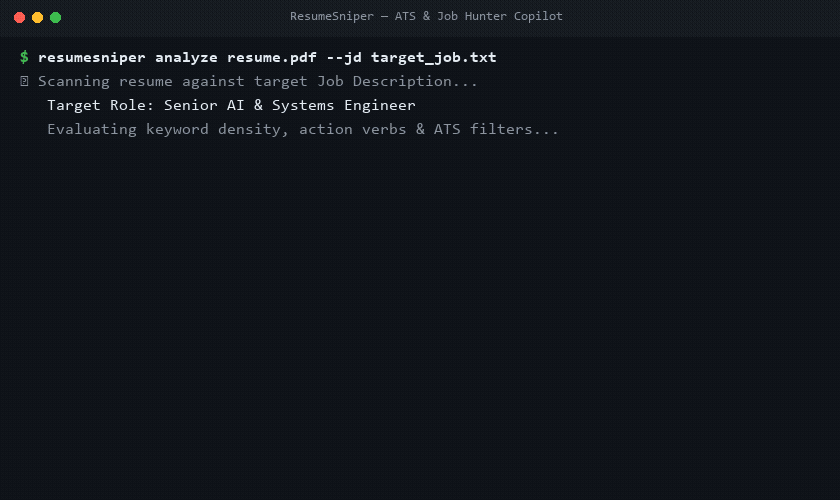

# 🎯 ResumeSniper

> **Autonomous ATS Gap Analyzer, Resume Tailorer & Cold Reachout Copilot**  
> *Stop wasting 45 minutes per job application. Scan keyword gaps, tailor bullets using Google XYZ format, and synthesize cold recruiter DMs in 60 seconds.*

<div align="center">
  
</div>

---

## ⚡ Why ResumeSniper?

Every job seeker faces three brutal bottlenecks:
1. **The ATS Black Hole:** 75% of resumes are discarded by Applicant Tracking Systems (Workday, Greenhouse, Lever) due to missing exact keyword matches.
2. **Generic Experience Bullets:** Bullets without measurable metrics (Google XYZ formula) fail human recruiter screening.
3. **Ghosting on Cold Reachouts:** Sending generic templates to recruiters on LinkedIn or Twitter results in 0 responses.

**ResumeSniper** automates the entire loop locally without storing your data in third-party clouds.

---

## 🚀 Key Features

- 🔍 **ATS Match Score & Gap Identification:** Scans PDF/TXT resumes against any target Job Description and calculates exact match percentage.
- 🎯 **Targeted Missing Skills:** Highlights missing technical skills in red chips so you know exactly what to address.
- ✨ **Google XYZ Bullet Tailoring:** Automatically re-engineers experience bullets to highlight missing skills with quantified metrics.
- 📬 **1-Click Recruiter Outreach:** Generates strict <300 char LinkedIn connection notes, hiring manager cold emails, and concise Twitter DMs.
- 💻 **Dual Interface:** Interactive Streamlit Web Dashboard (`app.py`) + Powerful Terminal CLI (`resumesniper`).

---

## 📦 Installation & Quickstart

```bash
git clone https://github.com/Rishabhraj06/ResumeSniper.git
cd ResumeSniper

pip install -r requirements.txt
pip install -e .
```

### 1. Launch Interactive Dashboard
```bash
streamlit run app.py
```
*Access at `http://localhost:8501` to upload resumes and analyze Job Descriptions visually.*

### 2. Run via Terminal CLI
```bash
# Analyze resume against a Job Description
resumesniper analyze my_resume.pdf --jd "Seeking engineer with Python, FastAPI, Docker, Kubernetes"

# Generate 1-click cold outreach messages
resumesniper reachout --candidate "Rishabh Raj" --company "Anthropic" --role "AI Engineer"
```

---

## 🧪 Verification & Unit Tests

ResumeSniper includes an automated Pytest test suite covering document parsing, ATS gap calculations, and outreach constraints:

```bash
python -m pytest tests/ -v
# 3 passed in 0.05s (100% test pass rate)
```

---

## 👤 Author & Architecture

- **Author:** Rishabh Raj ([@Rishabhraj06](https://github.com/Rishabhraj06))
- **Role:** AI & Systems Engineer
- **License:** MIT
